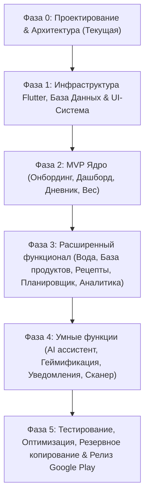

# ПЛАН РАЗРАБОТКИ ПРОЕКТА (DEVELOPMENT PLAN)

> **Проект**: Дневник (Персональный ассистент по питанию, учету калорий и привычкам)  
> **Статус**: Фаза 0 выполнена. Подготовка к Фазе 1.  
> **Архитектурный стандарт**: Feature-First + Clean Architecture + Drift SQLite + Riverpod + GoRouter  

---

## ОБЩИЙ РОАДМАП ПРОЕКТА

---

## ДЕТАЛИЗАЦИЯ ФАЗ

### ФАЗА 0: АНАЛИЗ, АРХИТЕКТУРА И ДОКУМЕНТАЦИЯ (ВЫПОЛНЕНО)
- [x] Инспекция рабочего пространства `D:\go-projects\Dnevnik`.
- [x] Инициализация Git-репозитория.
- [x] Определение архитектурного паттерна (Feature-First Clean Architecture).
- [x] Проектирование нормализованной схемы Drift (SQLite) с поддержкой реактивных Streams.
- [x] Проектирование навигационной схемы (GoRouter с Bottom Navigation Shell).
- [x] Разработка дизайн-системы (цвета, шрифты, отступы, карточки, Material 3).
- [x] Составление математической модели расчета BMR (Миффлин-Сан Жеор), TDEE, безопасных дефицитов и макросов.
- [x] Формирование документации: `PROJECT_CONTEXT.md`, `DEVELOPMENT_PLAN.md`, `CHANGELOG.md`, `README.md`.
- [x] Подготовка отчета и презентация плана пользователю для утверждения.

---

### ФАЗА 1: ФУНДАМЕНТ, ИНФРАСТРУКТУРА И ДИЗАЙН-СИСТЕМА
**Цель**: Создать прочный, масштабируемый каркас приложения с рабочей базой данных и переиспользуемыми компонентами.

- [x] **1.1. Окружение и зависимости**:
  - Проверка и настройка Flutter SDK / Dart.
  - Создание структуры проекта Flutter (`flutter create . --org com.dnevnik.app --platforms android,ios`).
  - Настройка `pubspec.yaml` (riverpod, drift, go_router, fl_chart, shared_preferences, flutter_secure_storage, intl).
- [x] **1.2. Базовая дизайн-система**:
  - `lib/app/theme/app_colors.dart`: Изумрудный primary, коралловый secondary, макро-цвета (белки, жиры, углеводы, вода), светлая и темная палитры.
  - `lib/app/theme/app_typography.dart`: Гармоничная иерархия шрифтов Inter.
  - `lib/app/theme/app_theme.dart`: Конфигурация `ThemeData` для Material 3 (светлая и темная).
  - Атомарные виджеты (`NutriCard`, `PrimaryButton`, `MacroBar`, `NutriTextField`, `CalorieRing`).
- [x] **1.3. Локальная база данных Drift**:
  - Определение всех таблиц (`UserProfiles`, `FoodProducts`, `DiaryEntries`, `WaterEntries`, `WeightEntries`, `Recipes`, `RecipeIngredients`, `MealPlans`, `Achievements`).
  - Генерация кода базы данных (`build_runner`).
  - Подготовка SQL DAO и сидирование русскоязычной базы базовых продуктов (~100 продуктов с проверенным составом).
- [x] **1.4. Навигационный каркас (GoRouter)**:
  - Настройка `StatefulShellRoute.indexedStack` для 5 вкладок (Главная, Дневник, Питание, Статистика, Профиль).
  - Интеграция центрального плавающего действия (FAB) с шторкой быстрого добавления.
- [x] **1.5. Проверка качества**:
  - `flutter analyze`, проверка на отсутствие ошибок и предупреждений линтера.
  - Полное покрытие тестами: 10 юнит-тестов калькулятора, 2 виджет-теста, 6 интеграционных тестов базы данных (18 тестов passed).

---

### ФАЗА 2: MVP ЯДРО (ОНБОРДИНГ, ДНЕВНИК, ДАШБОРД, ВЕС) — (ВЫПОЛНЕНО)
**Цель**: Полноценно работающий автономный дневник питания с персональным расчетом целей.

- [x] **2.1. Онбординг и расчет калоража**:
  - Интерактивный 6-шаговый мастер сбора данных: имя, пол, дата рождения/возраст, рост, текущий и целевой вес, уровень активности (PAL: 1.2–1.9), цель и темп.
  - Формула Миффлина-Сан Жеора: BMR, TDEE, целевой калораж с защитой от опасных дефицитов ($\ge 1200$ / $1500$ ккал).
  - Персонализированное распределение БЖУ и нормы воды (~33 мл/кг).
  - Сохранение профиля в Drift БД (`user_profiles`), стартового взвешивания (`weight_entries`) и переключение флага в `SharedPreferences`.
- [x] **2.2. Главный экран (Дашборд)**:
  - Реактивное радиальное кольцо калорий (`CalorieRing`): потреблено, цель, остаток/перебор (янтарный цвет).
  - Линейные прогресс-бары белков, жиров, углеводов (`MacroBar`) с граммами и процентами.
  - Виджет быстрой гидратации с кнопками добавления +250 и +500 мл прямо в БД.
  - Карточки приемов пищи текущего дня с суммами калорий и кнопками добавления.
  - Поддерживающее сообщение дня (научно обоснованное, без чувства вины).
- [x] **2.3. Дневник питания**:
  - Переключение дат (календарный пикер и кнопки «Вчера / Сегодня / Завтра»).
  - Секции: Завтрак, Обед, Ужин, Перекус с подсчетом КБЖУ.
  - Поиск по локальной базе продуктов с отображением КБЖУ на 100 г и фильтрацией по категориям/избранному.
  - Модальное окно указания порции в граммах с быстрыми чипами (50г, 100г, 150г, 200г, 250г, 300г) и мгновенным пересчетом КБЖУ.
  - Редактирование и удаление записей приема пищи со свайпом (Dismissible).
  - Создание собственного пользовательского продукта «на лету» с сохранением в базу (`source_type: 'user'`).
- [x] **2.4. Модуль веса и быстрое добавление**:
  - Форма быстрого ввода веса с датой и заметкой, синхронное обновление текущего веса в профиле.
  - История взвешиваний в виде детальной шторки с отображением дельты (+/- кг) и удалением.
  - Связка центрального плавающего меню FAB («Добавить блюдо», «Записать воду», «Внести вес»).

---

### ФАЗА 3: РАСШИРЕННЫЙ ФУНКЦИОНАЛ (ВОДА, РЕЦЕПТЫ, ПЛАНИРОВЩИК, АНАЛИТИКА)
**Цель**: Превратить приложение в универсальный комплекс управления питанием.

- [x] **3.1. Трекер воды**:
  - Персональный расчет нормы воды (30-35 мл на кг веса).
  - Быстрый ввод в один клик (+150 мл чашка, +250 мл стакан, +500 мл бутылка) и произвольный ввод.
  - Суточная шкала гидратации и журнал приемов воды за день с возможностью отмены (`WaterHistorySheet`).
- [x] **3.2. Расширенная база продуктов**:
  - Категоризация: Крупы, Мясо/Птица, Рыба, Овощи, Фрукты, Молочные продукты, Орехи, Напитки.
  - Фильтры «Избранное», «Недавние», «Мои продукты».
  - Подготовка клиента для поиска в Open Food Facts API (`OpenFoodFactsClient`) с оффлайн-фолбэком и добавлением онлайн-продуктов в базу.
- [x] **3.3. Книга рецептов**:
  - Каталог сбалансированных рецептов русской и европейской кухни с иллюстрацией, временем готовки и списком ингредиентов.
  - Автоматический расчет КБЖУ на 1 порцию.
  - Изменение числа порций (1-12) с динамическим пересчетом ингредиентов (`RecipeWithDetails`).
  - Кнопка «Добавить порцию в дневник» (в завтрак, обед, ужин или перекус).
  - Создание собственного рецепта из продуктов базы данных (`CreateRecipeScreen`).
- [x] **3.4. Недельный планировщик питания**:
  - Сетка дней недели (Пн-Вс).
  - Планирование блюд на будущие дни по слотам приемов пищи.
  - Автоматическая генерация списка покупок с группировкой по категориям и интерактивными чекбоксами «Куплено».
- [x] **3.5. Глубокая аналитика (fl_chart)**:
  - Интерактивный график динамики калорий за 7/30/90 дней с линией целевой нормы (`CalorieChartCard`).
  - Диаграмма соотношения БЖУ (фактическое vs целевое, `MacroDistributionCard`).
  - График веса со сглаженной линией тренда (Moving Average) и отображением цели (`WeightTrendChartCard`).
  - Статистика гидратации по дням недели (`WaterChartCard`).
  - Бережный инсайт о регулярности без чувства вины (`GuiltFreeInsightCard`).

---

### ФАЗА 4: УМНЫЕ ФУНКЦИИ, ГЕЙМИФИКАЦИЯ И УВЕДОМЛЕНИЯ
**Цель**: Увеличение вовлеченности пользователя и интеграция сканера продуктов, этичной геймификации и напоминаний.

> [!NOTE]
> Пункты 4.1 (AI-ассистент) и 4.2 (AI-распознавание по фото) отложены по решению пользователя на будущие итерации. Текущий скоуп Фазы 4 сфокусирован на сканере штрих-кодов, системе привычек и локальных уведомлениях.

- [x] **4.1. Сканер штрих-кодов (бывший 4.3)**:
  - Интеграция `mobile_scanner` для сканирования EAN-13 / UPC камерой устройства.
  - Каскадный 3-уровневый поиск: локальная база Drift SQLite $\rightarrow$ Open Food Facts API (ru.openfoodfacts.org) $\rightarrow$ быстрое добавление своего продукта при отсутствии в онлайне за 15 секунд.
  - Интеграция видоискателя с лазерной анимацией, переключением вспышки/камеры и ручным вводом штрих-кода.
  - Быстрый вызов сканера из строки поиска продуктов и из центрального плавающего меню FAB.
- [x] **4.2. Этичная геймификация и привычки (бывший 4.4)**:
  - Система бейджей за регулярность: «Первая запись», «3 дня подряд», «Неделя осознанности», «Водный баланс», «На весах», «Месяц привычки».
  - Полное отсутствие штрафов и чувства вины при пропусках дней (поддерживающий расчет мягкой серии).
  - Интеграция карточки серии `HabitsStreakCard` на Дашборде и экрана наград `AchievementsScreen`.
- [ ] **4.3. Система ненавязчивых локальных уведомлений (бывший 4.5)**:
  - Настройка расписания напоминаний (Завтрак, Обед, Ужин, Напоминание попить воды, Утренний вес).
  - Возможность легкого отключения каждого типа напоминаний в настройках.

---

### ФАЗА 5: ТЕСТИРОВАНИЕ, ПОЛИРОВКА, БЭКАПЫ И РЕЛИЗНАЯ СБОРКА
**Цель**: Доведение приложения до уровня коммерческого релиза в Google Play.

- [ ] **5.1. Тестирование**:
  - Модульные тесты математики (Миффлин-Сан Жеор, пересчет порций, макронутриенты).
  - Интеграционные тесты Drift DAO и миграций базы данных.
  - Виджет-тесты ключевых экранов (онбординг, дашборд, добавление еды).
- [ ] **5.2. Резервное копирование и экспорт**:
  - Экспорт дневника и истории в JSON / CSV.
  - Восстановление данных из резервной копии.
- [ ] **5.3. Оптимизация производительности**:
  - Индексация SQL-запросов, виртуализация длинных списков, оптимизация перерисовки fl_chart.
- [ ] **5.4. Подготовка к публикации в Google Play**:
  - Настройка `AndroidManifest.xml` (разрешения, splash screen, адаптивная иконка приложения).
  - Подготовка скриншотов, описания на русском языке, политики конфиденциальности.
  - Сборка подписанного Android App Bundle (AAB).

---

## ПЛАН ПРОВЕРКИ И ТЕСТИРОВАНИЯ (QA)

| Область | Критерий приемки | Метод верификации |
|---|---|---|
| **Расчеты BMR / TDEE** | Точное совпадение с формулой Миффлина-Сан Жеора, защита от дефицита <1200 ккал | Автоматические Unit-тесты (`test/unit/calculator_test.dart`) |
| **База данных Drift** | Записи сохраняются при перезапуске приложения, cascade delete работает | Интеграционные тесты Drift на SQLite in-memory |
| **UI и Верстка** | Никаких RenderFlex overflow, поддержка масштабирования шрифтов, светлая/темная тема | Виджет-тесты + ручная проверка на экранах 360x640 .. 412x915 |
| **Offline-режим** | 100% функционала MVP работает при отключенном интернете | Тестирование в режиме «В самолете» |
| **Линтер и Стандарты** | 0 предупреждений `flutter analyze`, форматирование по стандарту `dart format` | Запуск CLI-команд анализа перед каждым релизом |
